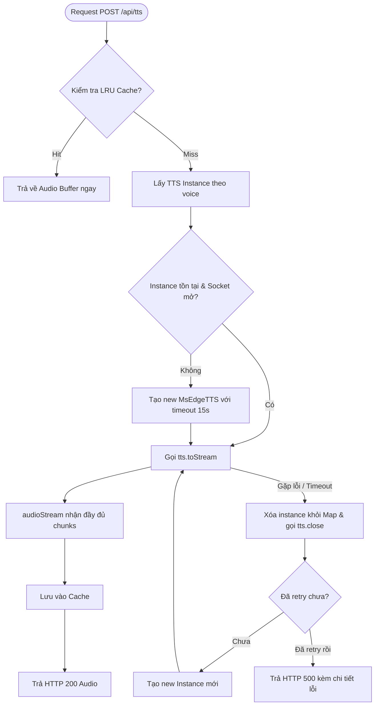

# ĐẶC TẢ KỸ THUẬT: KHẮC PHỤC TIMEOUT EDGE-TTS & CHUYỂN CHƯƠNG KHÔNG ĐỘ TRỄ (SEAMLESS TRANSITION)

> **Dự án:** AudioEpub — Web App Đọc & Nghe Sách EPUB trên Trình duyệt  
> **Tài liệu:** Technical Specification (Spec MD)  
> **Trạng thái:** Chờ User duyệt & quyết định các phương án thiết kế  
> **Phiên bản:** 1.0.0  

---

## 1. BỐI CẢNH & PHẠM VI (CONTEXT & SCOPE)

Người dùng gặp 2 lỗi nghiêm trọng ảnh hưởng trực tiếp đến trải nghiệm nghe sách:
1. **Lỗi Timeout Edge-TTS:** Server văng lỗi `Edge-TTS stream error: Error: Edge TTS connection timed out after 10000 milliseconds` tại `msedge-tts/dist/MsEdgeTTS.js:156:24`.
2. **Lỗi Delay Khi Chuyển Chương:** Trong suốt một chương thì tốc độ đọc rất ổn định, chuyển câu tức thì không có độ trễ; nhưng khi nghe hết câu cuối và nhảy sang chương mới thì bị khoảng lặng (delay) kéo dài **2 đến 4 giây**.

Tài liệu này đặc tả toàn bộ giải pháp kỹ thuật, phân tích rủi ro chuyên sâu và xác định các quyết định then chốt từ phía Người dùng trước khi tiến hành viết code.

---

## 2. USER STORIES & ACCEPTANCE CRITERIA (Lead BA)

### 🎯 US-01: Tự phục hồi kết nối Edge-TTS & Chống Zombie Socket
* **As a:** Người nghe truyện sử dụng giọng đọc AI Studio (Edge-TTS).
* **I want to:** Khi kết nối WebSocket với Microsoft bị đứt ngầm do idle hoặc mạng lag, hệ thống tự động dọn dẹp và kết nối lại ngay lập tức mà không làm dừng đọc.
* **So that:** Không bị gián đoạn âm thanh hoặc gặp lỗi `Edge TTS connection timed out after 10000 milliseconds`.

#### Acceptance Criteria (AC):
* **AC-01.1 (Auto Evict on Error):** Khi `audioStream` của Edge-TTS bắt lỗi `error` hoặc timeout, server middleware **bắt buộc** phải gọi `tts.close()` và xóa bỏ instance đó khỏi `ttsInstances` map.
* **AC-01.2 (Automatic Retry on Server):** Nếu một request tổng hợp bị lỗi kết nối hoặc timeout lần đầu, server tự động khởi tạo fresh instance và retry ngay lập tức (tối đa 1 lần). Chỉ trả HTTP 500 nếu lần retry cũng thất bại.
* **AC-01.3 (Configurable Timeout):** Tăng `connectionTimeoutMs` từ 10.000ms lên 15.000ms để chịu tải tốt hơn trên các đường truyền quốc tế chập chờn.
* **AC-01.4 (Idle Connection Pruning):** Sau 90 giây không có yêu cầu phát sinh, socket Edge-TTS tự động đóng êm dịu để tránh bị Microsoft kill ngầm tạo thành zombie connection.

---

### 🎯 US-02: Chuyển chương mượt mà không độ trễ (Zero-Latency Seamless Transition)
* **As a:** Người nghe sách nói nghe truyện liên tục nhiều chương.
* **I want to:** Khi câu cuối cùng của chương hiện tại vừa dứt lời, câu đầu tiên của chương kế tiếp vang lên mượt mà (độ trễ < 150ms).
* **So that:** Trải nghiệm nghe liền mạch như một cuốn audiobook được thu âm liên tục, không bị gián đoạn hay khựng lại 2-4 giây.

#### Acceptance Criteria (AC):
* **AC-02.1 (Cross-Chapter Audio Prefetch):** Khi TTS đang phát đến câu áp chót ($N-1$) hoặc câu cuối ($N$) của chương hiện tại, hệ thống phải trích xuất ngầm 1–2 câu đầu của chương tiếp theo và gửi prefetch vào Lookahead Queue.
* **AC-02.2 (OOM Compliance - No Premature DOM Render):** Quá trình nạp trước text của chương tiếp theo **tuyệt đối không** render iframe hoặc mount DOM vào `ReaderView` (giữ đúng Rule 1 OOM: mỗi thời điểm chỉ render duy nhất 1 chương vào DOM). Chỉ đọc text thuần thông qua epub spine reader.
* **AC-02.3 (Preserve Lookahead Cache on Chapter Switch):** Khi hàm `setSentencesList` được kích hoạt cho chương mới, không được gọi `clear()` làm mất blob audio đã nạp sẵn của câu đầu tiên.
* **AC-02.4 (Parallel Audio & DOM Render):** Khi câu cuối kết thúc, audio câu 1 của chương mới được kích hoạt phát ngay tức thì. Giao diện `ReaderView` thực hiện render DOM chương mới song song. Khi DOM sẵn sàng, highlight câu tự động ánh xạ vào câu đang phát.
* **AC-02.5 (End of Book Graceful Stop):** Ở chương cuối cùng của sách, sau câu cuối cùng, TTS chuyển trạng thái về `idle` an toàn, hiển thị thông báo hoàn thành sách mà không văng lỗi.

---

## 🏛️ 3. KIẾN TRÚC KỸ THUẬT & GIẢI PHÁP (Solution Architect)

### 3.1. Thiết kế kỹ thuật Server: Edge-TTS Connection Manager (`server/ttsMiddleware.js` & `server.cjs`)



#### Quy tắc quản lý vòng đời kết nối:
1. `ttsInstances` chuyển sang lưu trữ: `{ instance: MsEdgeTTS, lastUsed: number }`.
2. Bổ sung timer `setInterval` mỗi 30s: Quét và giải phóng những instance không có request trong 90s (`instance.close()`).
3. Đóng gói hàm `synthesizeWithRetry(voice, text, options)` có sẵn cơ chế bắt lỗi timeout, tự huỷ socket hỏng và retry 1 lần với kết nối mới.

---

### 3.2. Thiết kế kỹ thuật Client: Cross-Chapter Lookahead Engine (`useTTS.ts` & `ReaderView.tsx`)

```mermaid
sequenceDiagram
    autonumber
    participant Engine as useTTS (Lookahead Queue)
    participant Audio as HTMLAudioElement
    participant Helper as epubHelper (Headless Spine)
    participant Reader as ReaderView (DOM Iframe)
    participant Server as TTS Server (/api/tts)

    Note over Engine,Audio: Đang đọc câu N-1 của Chương hiện tại
    Engine->>Engine: Nhận diện sắp hết chương (currentIdx >= total - 2)
    Engine->>Helper: getNextChapterFirstSentences(nextHref)
    Note over Helper: Đọc text nhẹ từ book.spine (KHÔNG mount DOM)
    Helper-->>Engine: Trả về [câu 1, câu 2 của Chương mới]
    Engine->>Server: Prefetch TTS câu 1 chương mới
    Server-->>Engine: Trả về Audio Blob câu 1 chương mới
    Note over Engine: Blob câu 1 chương mới ĐÃ SẴN SÀNG TRONG RAM

    Audio->>Engine: onended (Câu cuối chương cũ kết thúc)
    
    par Phát âm thanh tức thì (0ms latency)
        Engine->>Audio: audio.src = blobUrl_ChươngMới; audio.play()
        Note over Audio: CÂU 1 CHƯƠNG MỚI PHÁT NGAY LẬP TỨC
    and Tải DOM song song ở chế độ nền
        Engine->>Reader: handleNextChapter()
        Reader->>Reader: rendition.display(nextHref)
        Reader->>Reader: DOM Render + tagAndExtractSentences()
        Reader-->>Engine: onSentencesReady(newSentences, keepIndex=0)
        Note over Reader: Highlight câu 1 sáng lên đồng bộ mượt mà
    end
```

---

## ⚠️ 4. MA TRẬN RỦI RO & BIỆN PHÁP GIẢM THIỂU (Risk Assessment)

Dưới đây là 6 rủi ro kỹ thuật đã được phân tích độc lập (QA & Reviewer Specialist):

| # | Rủi ro phát sinh | Mức độ | Kịch bản xảy ra | Giải pháp kỹ thuật xử lý triệt để |
|---|---|:---:|---|---|
| **R1** | **Chặn tự động phát (Autoplay block) trên iOS Safari** | **Cao** | Khi câu cuối kết thúc và sang câu 1 chương mới, nếu có khoảng trễ bất đồng bộ hoặc tạo mới thẻ `<audio>`, Safari coi đó là lượt phát không có user gesture và chặn đứng. | **Giải pháp:** Sử dụng duy nhất một phần tử `HTMLAudioElement` xuyên suốt (`neuralAudioRef.current`). Khi đổi audio source, gọi `audio.play()` ngay trong cùng event loop handler của `audio.onended`, không chèn `await` promise chậm. |
| **R2** | **Lệch pha (Race condition) giữa Audio và DOM** | **Trung bình** | Audio câu 1 chương mới phát trước (0ms), nhưng DOM của `ReaderView` phải mất 400ms mới vẽ xong iframe. Người dùng nghe thấy tiếng trước khi thấy chữ được highlight. | **Giải pháp:** Khi audio bắt đầu phát, Mini-player cập nhật tiêu đề chương ngay tức thì. Trong `ReaderView`, khi DOM chương mới kích hoạt xong callback `onSentencesReady`, hệ thống lập tức highlight câu số 0 và cuộn tự động đến câu đó. Độ trễ 300–400ms về mặt thị giác là hoàn toàn tự nhiên đối với hiệu ứng lật trang. |
| **R3** | **Người dùng nhảy chương bằng tay (Manual Skip)** | **Trung bình** | Người dùng bấm nút "Chương sau" hoặc chọn từ Mục lục (TOC) trong khi bộ đệm đang lưu audio prefetch của chương kế tiếp theo thứ tự tuần tự. | **Giải pháp:** Bổ sung tham số `chapterHref` vào khoá cache của Lookahead Queue. Nếu người dùng chuyển chương thủ công, gọi `lookaheadQueue.clear()` để huỷ sạch các câu dự đoán cũ, tránh phát nhầm câu của chương nhảy cóc. |
| **R4** | **Chương rỗng hoặc chỉ có ảnh minh hoạ (Comic / Illustration)** | **Thấp** | Một số sách EPUB có các chương chỉ chứa thẻ `` bìa hoặc lời đề từ không có văn bản chữ. | **Giải pháp:** Hàm trích xuất text kiểm tra: Nếu chương kế tiếp rỗng (`sentences.length === 0`), tiếp tục đệ quy quét nhanh chương tiếp theo ($N+2$) hoặc thông báo chuyển tiếp chương êm dịu mà không bị treo hàng đợi. |
| **R5** | **Chương cuối cùng của cuốn sách** | **Thấp** | TTS đọc đến câu cuối của chương cuối cùng, không còn chương tiếp theo để prefetch. | **Giải pháp:** Kiểm tra điều kiện `currentChapterIndex >= chapters.length - 1`. Khi câu cuối kết thúc, ngắt phát âm thanh, chuyển trạng thái sang `idle`, đóng thanh player và hiển thị thông báo "Đã hoàn thành cuốn sách". |
| **R6** | **Microsoft Edge-TTS Rate Limiting / WSS Block** | **Trung bình** | Nếu gửi prefetch quá nhiều câu cùng lúc hoặc retry liên tục khi mạng rớt, IP máy chủ có thể bị Microsoft tạm thời từ chối bắt tay (HTTP 403 / WSS rejection). | **Giải pháp:** Giới hạn Lookahead tối đa 2 câu (1 câu hiện tại + 1 câu kế tiếp). Hạn chế retry tối đa 1 lần với backoff 500ms. Thất bại 2 lần thì tự động fallback về giọng đọc trên thiết bị (Web Speech). |

---

## ❓ 5. CÁC QUYẾT ĐỊNH CẦN NGƯỜI DÙNG DUYỆT (Decisions Needed from User)

Trước khi tiến hành sửa code, xin ý kiến bạn lựa chọn 3 phương án thiết kế sau:

### 🔹 Quyết định 1: Khoảng nghỉ âm thanh khi chuyển chương (Transition Pause)
* **Phương án A (Khuyên dùng - Audio-Book Style):** Cho phép một khoảng nghỉ ngắn tự nhiên **400ms – 600ms** giữa câu cuối chương cũ và câu đầu chương mới (giả lập nhịp thở tự nhiên của phát thanh viên khi lật sang chương mới, đồng thời vừa vặn cho DOM chương mới render xong).
* **Phương án B (Tức thì - 0ms Delay):** Phát câu đầu chương mới ngay lập tức không nghỉ một mili-giây nào (giống hệt ngắt câu bình thường trong 1 chương).

> 👉 *Bạn chọn Phương án A hay Phương án B?*

---

### 🔹 Quyết định 2: Số câu nạp trước qua ranh giới chương (Cross-Chapter Prefetch Depth)
* **Phương án A (Khuyên dùng - Tiết kiệm RAM):** Chỉ prefetch trước **duy nhất 1 câu đầu tiên** của chương tiếp theo. Đủ để đảm bảo 0ms delay mà tiêu tốn cực ít bộ nhớ RAM và băng thông.
* **Phương án B (Dày dặn - Buffer 2 câu):** Prefetch trước **2 câu đầu tiên** của chương tiếp theo để tạo bộ đệm an toàn tuyệt đối ngay cả khi mạng lag.

> 👉 *Bạn chọn Phương án A hay Phương án B?*

---

### 🔹 Quyết định 3: Chính sách xử lý khi Edge-TTS Server lỗi liên tục (Fallback Policy)
* **Phương án A (Khuyên dùng):** Nếu server Edge-TTS retry 1 lần vẫn thất bại, hệ thống tự động phát câu đó bằng giọng Tiếng Việt của thiết bị (Web Speech API) và thông báo nhẹ cho người dùng, sau đó tiếp tục thử lại Edge-TTS ở câu sau (nghe không bị ngắt quãng).
* **Phương án B (Nghiêm ngặt):** Dừng phát, hiện thông báo lỗi để người dùng kiểm tra kết nối mạng hoặc đổi giọng bằng tay.

> 👉 *Bạn chọn Phương án A hay Phương án B?*
